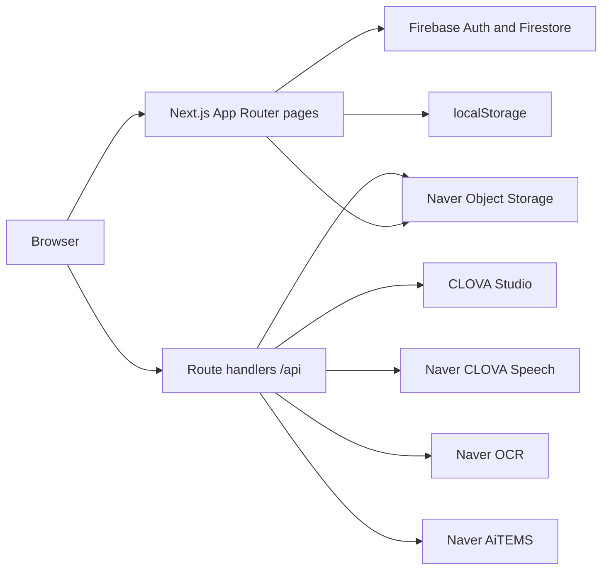
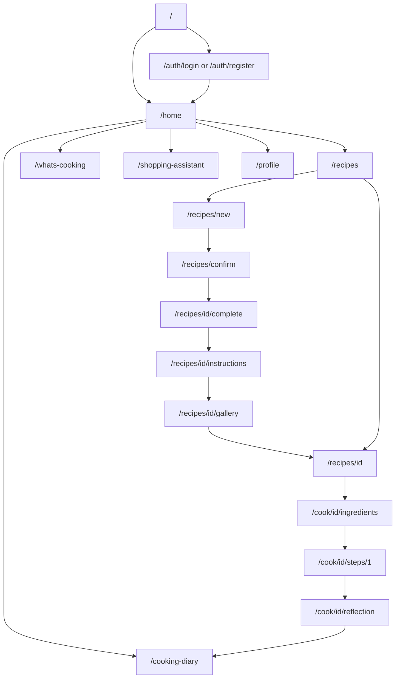
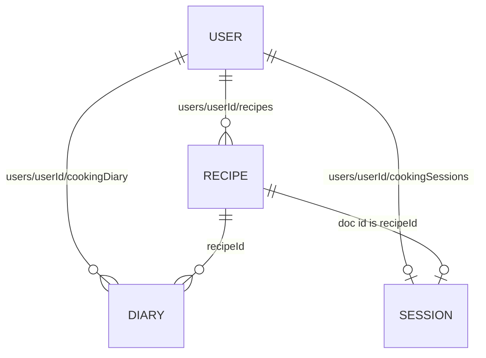

## Mom's Flavor

Mom's Flavor is a Vietnamese family-recipe app. People keep dishes from someone they cook with (mẹ, bà, người thân), cook them step by step, and write a short diary after. The in-app title is `Mom's Flavor - Ứng dụng công thức nấu ăn`.

**Tiếng Việt.** Ứng dụng công thức nấu ăn cho gia đình. Lưu món của người thân, nấu theo từng bước, rồi ghi nhật ký sau khi nấu. Hub sau khi đăng nhập là `/home`, với bốn lối: công thức, hôm nay nấu gì, nhật ký, trợ lý đi chợ.

There is no shared navbar. Each screen calls `router.push` or renders `PageHeader` with one back button. The root layout only mounts `AuthProvider`. Almost every `page.tsx` is a client component. `/home` and `/profile` redirect to `/auth/login` when there is no user. Recipe, cook, diary, and shopping screens also run logged out, through `localStorage`.

## Architecture



| Layer | Where | Role |
|-------|--------|------|
| UI | `app/**/page.tsx` | Client screens. Vietnamese copy. |
| Auth | `contexts/AuthContext.tsx`, `libs/auth.ts` | Email/password, Google popup, phone OTP on the login page. |
| Domain services | `libs/recipeService.ts`, `libs/firestore.ts` | Recipes, cooking sessions, diary. Logged-in path uses Firestore. Logged-out path uses `localStorage`. |
| AI | `libs/naverAi.ts` | Server-only. STT, OCR, and CLOVA Studio chat. |
| Media and datasets | `libs/naverStorage.ts` | S3-compatible client aimed at Naver Object Storage. |
| Recommendations sync | `libs/aitemsSync.ts` | After a diary save, uploads interaction, item, and user JSON under `cook-history/`. |

`firebase-admin` is only used by `scripts/seedSampleRecipes.js`. API routes use the client Firebase SDK. `axios` is in `package.json` and is not imported. Setup write-ups already in the repo: `NAVER_AI_SETUP.md`, `NAVER_STORAGE_SETUP.md`, `AITEMS_SETUP.md`, `FIRESTORE_MIGRATION_CHECKLIST.md`.

**Tiếng Việt.** Trình duyệt nói chuyện với page và `/api`. Page ghi Firebase hoặc `localStorage`. API gọi CLOVA, STT, OCR, Object Storage và AiTEMS. Ảnh nhật ký còn được upload thẳng từ màn reflection qua `libs/naverStorage.ts`.

## User flow



### Recipe wizard

1. `/recipes/new` saves the dish, then `POST /api/assistant/emotion-tags` attaches mood tags.
2. `/recipes/confirm` asks whether to finish the wizard.
3. `/recipes/[id]/complete` saves `ingredientsList`, `favoriteBrands`, `specialNotes`.
4. `/recipes/[id]/instructions` saves `instructions` as a JSON string plus `tips`. Voice uses `POST /api/upload/audio`, `/api/naver/stt`, `/api/naver/stt/long`, and `/api/clova/steps/analyze`.
5. `/recipes/[id]/gallery` saves `coverImage` and `galleryImages` through `POST /api/upload`.

`/recipes/[id]/edit` edits metadata only. `/recipes/[id]/media-tips` is a second tips screen and nothing in the app links to it.

### Cook mode

| Step | Route | What is stored |
|------|--------|----------------|
| Checklist | `/cook/[id]/ingredients` | Checkboxes stay in React state. On enter, a logged-in user clears `cookingSessions/{recipeId}` and the cook `localStorage` keys. |
| Steps | `/cook/[id]/steps/[stepNumber]` | Timers and completed step numbers in `cook-timers-{recipeId}` and `cook-completed-{recipeId}`. |
| Reflection | `/cook/[id]/reflection` | Logged in: `cookingDiary` plus images on Naver, then `syncCookingEvent`. Logged out: `localStorage` key `cooking-diary`. |

`hooks/useCookingSession.ts` writes the Firestore session shape, and no page imports it. The star rating is sent to AiTEMS and stored on the guest diary object. The Firestore `CookingDiaryEntry` type does not include `rating`.

### What's cooking and shopping

`/whats-cooking` can shuffle recipes locally, call `GET /api/recommendations` when a user is logged in and AiTEMS is enabled, `POST /api/assistant/ingredients`, `POST /api/assistant/emotion-search`, and `POST /api/nostalgia-story`. Missing ingredients are written into `localStorage` key `shopping-list`.

`/shopping-assistant` keeps that checklist in the browser and can ask `POST /api/assistant/shopping` for a plan. The AI checklist is not merged into the manual list.

The **Nấu ngay** button on `/whats-cooking` pushes `/cook/[id]/start-confirmation`. That page is not in the repo. The working cook entry is `/recipes/[id]` → `/cook/[id]/ingredients`. Login links to `/auth/forgot-password`, which is also not in the repo. `/recipes/select-to-cook` and `/admin` work by URL and are not linked from `/home`.

## Tech stack

| | |
|--|--|
| App | Next.js `16.0.10`, App Router, `reactCompiler: true` |
| UI | React `19.2.0`, React DOM `19.2.0` |
| Language | TypeScript `^5`, path alias `@/*` |
| Style | Tailwind CSS `^4`, `@tailwindcss/postcss` |
| Fonts | Geist and Geist Mono from `next/font`. `globals.css` sets the body face to Arial, Helvetica, sans-serif. |
| Motion | `lottie-react` `^2.4.1` |
| Auth and data | `firebase` `^12.5.0` |
| Admin seed script | `firebase-admin` `^13.6.0` |
| Object storage | `@aws-sdk/client-s3` `^3.922.0` against Naver Object Storage |
| Lint | ESLint `^9`, `eslint-config-next` `16.0.1` |
| Lockfile | `package-lock.json` |
| Tests / CI | None in the repo |

UI kit in `components/ui`: `PageContainer`, `PageHeader`, `LoadingSpinner`, `GradientButton`, `ActionCard`, `FormInput`, `GlassCard`. Pages use the first five. `FormInput` and `GlassCard` are exported and unused. Shared pieces outside the kit: `ConfirmModal`, `CompletedBadge`, `ImageUpload`.

`html` is `lang="en"`. Visible copy is Vietnamese, with a few English strings such as `Welcome` and `Loading...`.

## Routes

### Pages

| Route | Role |
|-------|------|
| `/` | Welcome. Login, register, or enter `/home`. |
| `/home` | Hub. Requires a user. |
| `/auth/login` | Email, Google, phone OTP. |
| `/auth/register` | Name, email, password. |
| `/profile` | Display name. Requires a user. |
| `/recipes` | Grid, filter by `instructor`, delete. |
| `/recipes/new` | Create metadata and emotion tags. |
| `/recipes/confirm` | Continue the wizard or go back to the list. |
| `/recipes/[id]` | Detail, cover upload, start cooking. |
| `/recipes/[id]/edit` | Metadata edit. |
| `/recipes/[id]/complete` | Ingredients, brands, notes. |
| `/recipes/[id]/instructions` | Steps, tips, voice. |
| `/recipes/[id]/gallery` | Cover and gallery. |
| `/recipes/[id]/media-tips` | Tips screen, no inbound link. |
| `/recipes/select-to-cook` | Pick a recipe to cook, no inbound link. |
| `/cook/[id]/ingredients` | Prep checklist. |
| `/cook/[id]/steps/[stepNumber]` | Timers and step progress. |
| `/cook/[id]/reflection` | Diary entry. |
| `/cooking-diary` | Timeline or grouped by recipe. |
| `/cooking-diary/[id]` | Entries for one recipe. |
| `/cooking-diary/entry/[id]` | One entry. |
| `/whats-cooking` | Random, AiTEMS, pantry, mood, nostalgia story. |
| `/shopping-assistant` | Checklist and AI plan. |
| `/admin` | Creates 10 sample Vietnamese recipes for the signed-in user. |

### API

| Route | Upstream |
|-------|----------|
| `POST /api/assistant/emotion-tags` | CLOVA Studio |
| `POST /api/assistant/emotion-search` | CLOVA Studio |
| `POST /api/assistant/ingredients` | CLOVA Studio |
| `POST /api/assistant/shopping` | CLOVA Studio |
| `POST /api/nostalgia-story` | CLOVA Studio |
| `POST /api/clova/steps/analyze` | CLOVA Studio |
| `POST /api/naver/stt` | Naver CLOVA Speech |
| `POST /api/naver/stt/long` | Fetch audio URL, then the same STT plus CLOVA Studio |
| `POST /api/clova/stt` | Same STT helper. No page calls it. |
| `POST /api/naver/ocr` | Naver Vision OCR. No page calls it. |
| `POST /api/upload` | Naver Object Storage, images |
| `POST /api/upload/audio` | Naver Object Storage, audio |
| `GET /api/recommendations` | AiTEMS when `NAVER_AITEMS_ENABLED=true`, then Firestore recipe docs |
| `GET/POST /api/recipes`, `GET/PUT/DELETE /api/recipes/[id]` | `RecipeService`. Pages talk to `RecipeService` directly and do not call these routes. |
| `POST /api/seed-recipes` | Seeds recipes for a `userId`. Guarded by a query key in the route file. |
| `GET /api/test-aitems` | Writes a sample AiTEMS JSON object to the bucket. |

Default hosts in `libs/naverAi.ts` and `libs/naverStorage.ts`:

| Service | Host |
|---------|------|
| STT | `https://naveropenapi.apigw.ntruss.com/recog/v1/stt` |
| OCR | `https://naveropenapi.apigw.ntruss.com/vision-ocr/v1/general` |
| CLOVA Studio | `https://clovastudio.stream.ntruss.com/testapp/v1/chat-completions/{model}` |
| Object Storage | `https://kr.object.ncloudstorage.com` |
| AiTEMS | `https://aitems.apigw.ntruss.com/services/{serviceId}/recommend` |

## Data

Firestore is per user. Rules in `firestore.rules` allow read and write only when `request.auth.uid` matches `{userId}`.



| Path | Shape |
|------|--------|
| `users/{userId}` | `id`, `email`, `name`, `createdAt` |
| `users/{userId}/recipes/{recipeId}` | `Recipe` from `types/recipe.ts`. `instructions` is a JSON string of steps. |
| `users/{userId}/cookingSessions/{recipeId}` | `userId`, `recipeId`, `completedSteps`, `activeTimers`, `lastUpdated`. The live step screen does not write this document. |
| `users/{userId}/cookingDiary/{entryId}` | `recipeId`, `dishName`, `cookDate`, `mistakes`, `improvements`, `images`, `userId`, `timestamp` |

`Recipe` also carries `dishName`, `recipeName`, `difficulty` (`very_easy` through `very_hard`), `cookingTime` (`very_fast` through `very_slow`), `instructor`, `description`, `ingredientsList`, `favoriteBrands`, `specialNotes`, `tips`, `coverImage`, `galleryImages`, `emotionTags`, `createdAt`, `updatedAt`.

Browser keys when Firebase is absent, or for cook progress:

| Key | Contents |
|-----|----------|
| `recipes` | Recipe list |
| `cooking-diary` | Diary entries, including rating on this path |
| `shopping-list` | Shopping assistant and what's-cooking |
| `cook-timers-{recipeId}` | Active timers |
| `cook-completed-{recipeId}` | Finished step numbers |
| `selectedRecipe` | Recipe payload stashed when opening a card |

AiTEMS objects are not Firestore documents. `syncCookingEvent` uploads JSON to `cook-history/interactions/`, `cook-history/items/`, and `cook-history/users/` in the Naver bucket.

## Project layout

```
moms-flavor-client/
├── app/
│   ├── layout.tsx                 # AuthProvider, Geist
│   ├── page.tsx                   # welcome
│   ├── home/  auth/  profile/  admin/
│   ├── recipes/  cook/  cooking-diary/
│   ├── whats-cooking/  shopping-assistant/
│   └── api/                       # assistant, naver, clova, upload, recipes
├── components/                    # ui kit, ImageUpload, ConfirmModal
├── contexts/AuthContext.tsx
├── hooks/useCookingSession.ts     # not used by a page
├── libs/
│   ├── firebase.ts  auth.ts  firestore.ts  recipeService.ts
│   ├── naverAi.ts  naverStorage.ts  aitemsSync.ts
├── types/recipe.ts
├── scripts/                       # admin seed, AiTEMS sample uploads
├── public/                        # app images, about 217 PNGs
├── firestore.rules
├── AITEMS_SETUP.md
├── NAVER_AI_SETUP.md
├── NAVER_STORAGE_SETUP.md
└── FIRESTORE_MIGRATION_CHECKLIST.md
```

`public/next.svg`, `globe.svg`, `file.svg`, `window.svg`, and `vercel.svg` are leftover files from the app scaffold. App art lives under `public/assets/`.

## Environment

Nothing under `.env*` is committed. Put these in `.env.local` for local dev, and the same server keys on the host you run in production.

| Group | Names |
|-------|--------|
| Firebase client | `NEXT_PUBLIC_FIREBASE_API_KEY`, `NEXT_PUBLIC_FIREBASE_AUTH_DOMAIN`, `NEXT_PUBLIC_FIREBASE_PROJECT_ID`, `NEXT_PUBLIC_FIREBASE_STORAGE_BUCKET`, `NEXT_PUBLIC_FIREBASE_MESSAGING_SENDER_ID`, `NEXT_PUBLIC_FIREBASE_APP_ID` |
| Naver storage | `NEXT_PUBLIC_NAVER_ENDPOINT`, `NEXT_PUBLIC_NAVER_REGION`, `NEXT_PUBLIC_NAVER_BUCKET`, `NAVER_ACCESS_KEY`, `NAVER_SECRET_KEY` |
| STT | `NAVER_STT_ENDPOINT`, `NAVER_CLOUD_CLIENT_ID`, `NAVER_CLOUD_CLIENT_SECRET`, `NAVER_STT_LANG`, `NEXT_PUBLIC_STT_LANG` |
| OCR | `NAVER_OCR_SECRET`, `NAVER_OCR_ENDPOINT` |
| CLOVA Studio | `CLOVA_STUDIO_API_KEY`, `CLOVA_STUDIO_REQUEST_ID`, `CLOVA_STUDIO_API_URL`, `CLOVA_STUDIO_SHORT_MODEL`, `CLOVA_STUDIO_LONG_MODEL` |
| AiTEMS | `NAVER_AITEMS_ENABLED`, `NAVER_AITEMS_API_KEY`, `NAVER_AITEMS_SERVICE_ID` |
| Admin seed script | `FIREBASE_SERVICE_ACCOUNT_PATH` or `FIREBASE_SERVICE_ACCOUNT_JSON`, `SEED_USER_ID` |

Defaults in code: STT language `Vi`, CLOVA model `HCX-003`, storage endpoint `https://kr.object.ncloudstorage.com`, region `kr-standard`, bucket `moms-flavor-images`.

```bash
npm install
npm run dev
```

Open `http://localhost:3000`.

Optional data loads:

```bash
node scripts/seedSampleRecipes.js
npx tsx scripts/upload-sample-aitems-data.ts
```

`/admin` seeds ten recipes into the signed-in user's Firestore list without the admin SDK. Several `/api/*` handlers set `export const runtime = 'nodejs'` because they use buffers and the S3 client.

**Tiếng Việt.** Cài dependency, tạo `.env.local` với Firebase và Naver, rồi `npm run dev`. Auth và Firestore cần sáu biến `NEXT_PUBLIC_FIREBASE_*`. Ảnh và giọng nói cần key Object Storage. Gợi ý AI cần CLOVA Studio. AiTEMS chỉ chạy khi `NAVER_AITEMS_ENABLED=true`.
